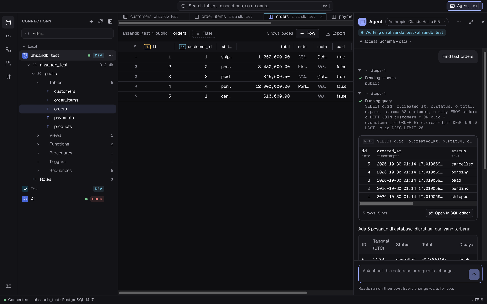

# AhsanDB Visualizer

Cross-platform desktop database client for PostgreSQL, MySQL, MariaDB and SQLite. Features:
- multiple connections with SSH tunnels;
- a SQL editor, data viewer, ER diagram and visual object editors;
- import/export;
- an AI agent whose changes need your approval.



## Tech stack

| Layer | Technology | Version |
|---|---|---|
| Toolchain | Rust (edition 2024) | 1.99.1 |
| | Node.js / npm (nvm, `.nvmrc`) | 24.22.1 / 11.19.1 |
| App shell | Tauri | 2.12.5 (CLI 2.12.4) |
| Backend | sqlx (Postgres, MySQL, SQLite) | 0.8.6 |
| | tokio | 1.54.1 |
| | russh (SSH tunnel) | 0.64.1 |
| | reqwest (AI providers) | 0.13.5 |
| | ring (secret encryption) | 0.17.14 |
| Frontend | React | 19.3.1 |
| | TypeScript | 7.0.2 |
| | Vite | 8.3.5 |
| | Tailwind CSS | 4.3.3 |
| | CodeMirror | 6.0.2 |
| | React Flow (@xyflow/react) | 12.12.0 |
| | ECharts | 6.1.0 |
| | sql-formatter | 15.9.0 |
| Tests | Vitest | 5.0.5 |

## Prerequisites

You need:
- Rust (via rustup);
- Node.js 24.22.1 via nvm (`nvm install && nvm use` reads `.nvmrc`);
- on macOS, Xcode Command Line Tools (`xcode-select --install`).

To try the app against a real database, optionally run a local PostgreSQL and/or MySQL/MariaDB. SQLite needs no server.

## Run

```sh
npm install
npm run tauri dev     # build the Rust backend and open the desktop app
npm run dev           # browser-only UI with mock data at http://localhost:1420 (development only)
```

The first build compiles the Rust crates and takes a few minutes.

App data lives in the OS app data folder under `com.ahsandb.visualizer`. On macOS that is `~/Library/Application Support/com.ahsandb.visualizer/`. It contains:
- `app.db`: connections (without passwords), query history and agent chats.
- `secrets.bin`: passwords and API keys, encrypted with AES-256-GCM.
- `secrets.key`: the key for `secrets.bin`.

`secrets.bin` and `secrets.key` are readable only by your user (mode 0600). The OS keychain is not used. This protects secrets from casual reads and copied backups, but not from malware running as your user.

## Sample database

```sh
createdb ahsandb_test && psql -d ahsandb_test -f scripts/seed/postgres.sql
mysql -uroot -e "CREATE DATABASE IF NOT EXISTS ahsandb_test" && mysql -uroot ahsandb_test < scripts/seed/mysql.sql
scripts/dev-sshd.sh   # throwaway SSH server on 127.0.0.1:2222 for tunnel testing
```

The connection dialog's **Database** field accepts:
- one name;
- a comma-separated list;
- nothing, to show all databases.

## AI agent

1. Add an API key in **Settings → AI** (Anthropic, OpenAI, OpenRouter, DeepSeek or Gemini).
2. Open the agent with **⌘J**.
3. Each connection's **AI access** controls what the agent may read: Off, Schema only, or Schema + data.

What the agent may do:
- It runs read queries directly.
- Every change waits for your approval.
- For critical actions on production connections, you must also type the object name.

## Test

```sh
npm run typecheck && npm test
cd src-tauri && cargo test && cargo clippy --all-targets -- -D warnings
```

The PostgreSQL, MySQL and SSH integration tests run only when these variables are set:

```sh
AHSANDB_TEST_PG=postgres://$(whoami)@localhost:5432/ahsandb_test \
AHSANDB_TEST_MYSQL=mysql://root@localhost:3306/ahsandb_test \
AHSANDB_TEST_SSHD=1 cargo test
```

Tests leave `ahsandb_test` unchanged: they work on temporary `ahsandb_t_<random>` objects. AI tests never call a real provider.

## Build

Build on the target OS, since Tauri does not cross-compile reliably. Output goes to `src-tauri/target/release/bundle/`. Builds are not code-signed.

| OS | Extra prerequisites | Command |
|---|---|---|
| macOS | Xcode Command Line Tools | `npm run tauri build` (`.app`, `.dmg`) |
| Windows 10/11 | Visual Studio Build Tools ("Desktop development with C++"); WebView2 ships with Windows | `npm run tauri build -- --bundles msi,nsis` |
| Linux (Debian/Ubuntu) | `sudo apt install libwebkit2gtk-4.1-dev libssl-dev librsvg2-dev libayatana-appindicator3-dev build-essential file` | `npm run tauri build -- --bundles deb,appimage` |

Windows and Linux builds are untested so far. Known gaps there:
- The title bar is styled for macOS, so it shows twice with an empty gap.
- Shortcut hints show `⌘` (Ctrl works).
- SSH agent auth is unavailable on Windows; use a password or key file instead.

## License

[Apache License 2.0](LICENSE)
